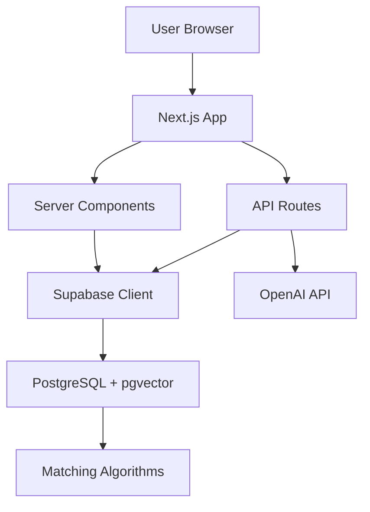

# HelloEveryone Documentation Index

## 🚀 Quick Start

For immediate development setup, see:
1. **[CLAUDE.md](../CLAUDE.md)** - Main project overview and development commands
2. **[DATABASE_SETUP.md](DATABASE_SETUP.md)** - Database initialization
3. **[.env.example](../.env.example)** - Environment configuration

## 📚 Documentation Structure

### Architecture & Design

| Document | Purpose | Key For |
|----------|---------|---------|
| **[ARCHITECTURE.md](ARCHITECTURE.md)** | System architecture overview, tech stack, directory structure | Understanding overall system design |
| **[API_ROUTES.md](API_ROUTES.md)** | Complete API documentation with examples | API development and integration |
| **[DATABASE_SCHEMA.md](DATABASE_SCHEMA.md)** | Database tables, relationships, RLS policies | Database operations and queries |
| **[MATCHING_SYSTEM.md](MATCHING_SYSTEM.md)** | Matching algorithms and scoring logic | Understanding core business logic |

### Development Guides

| Document | Purpose | Key For |
|----------|---------|---------|
| **[AUTHENTICATION.md](AUTHENTICATION.md)** | Auth system, server/client auth, OAuth setup | Authentication implementation |
| **[COMPONENTS.md](COMPONENTS.md)** | Component structure, guidelines, patterns | Frontend development |
| **[HOOKS.md](HOOKS.md)** | Custom React hooks documentation | Reusable logic and state management |
| **[PWA.md](PWA.md)** | Progressive Web App features and config | Mobile and offline functionality |

### Implementation Details

| Document | Purpose | Key For |
|----------|---------|---------|
| **[RSVP_SYSTEM.md](RSVP_SYSTEM.md)** | Event RSVP functionality and capacity management | Event feature development |
| **[TESTING.md](TESTING.md)** | Testing strategy, examples, CI/CD setup | Quality assurance and testing |
| **[DATABASE_SETUP.md](DATABASE_SETUP.md)** | Database initialization and configuration | Environment setup |

### Planning Documents

| Document | Purpose | Key For |
|----------|---------|---------|
| **[helloeveryone-implementation-plan.md](helloeveryone-implementation-plan.md)** | Original implementation roadmap | Historical context and planning |
| **[implementation-phases-doc.md](implementation-phases-doc.md)** | Phased implementation approach | Project management |

## 🎯 Documentation by Use Case

### New Developer Onboarding

1. **Start Here**: [CLAUDE.md](../CLAUDE.md)
2. **Environment Setup**: [.env.example](../.env.example) → [DATABASE_SETUP.md](DATABASE_SETUP.md)
3. **Architecture Understanding**: [ARCHITECTURE.md](ARCHITECTURE.md)
4. **Development Flow**: [COMPONENTS.md](COMPONENTS.md) + [HOOKS.md](HOOKS.md)

### API Development

1. **API Overview**: [API_ROUTES.md](API_ROUTES.md)
2. **Authentication**: [AUTHENTICATION.md](AUTHENTICATION.md)
3. **Database Schema**: [DATABASE_SCHEMA.md](DATABASE_SCHEMA.md)
4. **Business Logic**: [MATCHING_SYSTEM.md](MATCHING_SYSTEM.md)

### Frontend Development

1. **Component Structure**: [COMPONENTS.md](COMPONENTS.md)
2. **State Management**: [HOOKS.md](HOOKS.md)
3. **Authentication**: [AUTHENTICATION.md](AUTHENTICATION.md)
4. **PWA Features**: [PWA.md](PWA.md)

### Database Development

1. **Schema Overview**: [DATABASE_SCHEMA.md](DATABASE_SCHEMA.md)
2. **Setup Guide**: [DATABASE_SETUP.md](DATABASE_SETUP.md)
3. **Matching Logic**: [MATCHING_SYSTEM.md](MATCHING_SYSTEM.md)
4. **RSVP System**: [RSVP_SYSTEM.md](RSVP_SYSTEM.md)

### Testing & QA

1. **Testing Strategy**: [TESTING.md](TESTING.md)
2. **API Testing**: [API_ROUTES.md](API_ROUTES.md)
3. **Component Testing**: [COMPONENTS.md](COMPONENTS.md)
4. **PWA Testing**: [PWA.md](PWA.md)

### DevOps & Deployment

1. **Environment Config**: [.env.example](../.env.example)
2. **Database Setup**: [DATABASE_SETUP.md](DATABASE_SETUP.md)
3. **PWA Deployment**: [PWA.md](PWA.md)
4. **Testing Pipeline**: [TESTING.md](TESTING.md)

## 🔍 Quick Reference

### Key Development Commands

```bash
# Development
npm run dev          # Start dev server
npm run build        # Production build
npm run type-check   # TypeScript checking
npm run lint         # Code linting

# Database
npm run db:setup     # Initialize database
npm run db:seed      # Populate sample data

# Testing
npm run test         # Unit tests
npm run test:e2e     # End-to-end tests
npm run test:coverage # Coverage report
```

### Important File Locations

```
📁 Core Configuration
├── CLAUDE.md                 # Main project guide
├── .env.example             # Environment variables
├── package.json             # Dependencies and scripts
└── next.config.js           # Next.js configuration

📁 Source Code Structure
├── app/                     # Next.js App Router
│   ├── (public)/           # Public pages
│   ├── (protected)/        # Authenticated pages
│   └── api/                # API routes
├── components/             # React components
├── lib/                   # Business logic
├── hooks/                 # Custom React hooks
└── types/                 # TypeScript definitions

📁 Database & Testing
├── scripts/setup-db.js     # Database initialization
├── tests/                  # Test files
└── playwright.config.ts    # E2E test config
```

### Environment Variables Priority

**Required for Basic Functionality:**
- `NEXT_PUBLIC_SUPABASE_URL`
- `NEXT_PUBLIC_SUPABASE_ANON_KEY`
- `SUPABASE_SERVICE_ROLE_API_KEY`

**Required for Full Features:**
- `OPENAI_API_KEY` (matching system)
- `DB_PASSWORD` (database setup)

**Optional Enhancements:**
- `GOOGLE_CLIENT_ID` (OAuth)
- `NEXT_PUBLIC_SENTRY_DSN` (monitoring)

## 🏗️ Architecture Overview

### Tech Stack Summary

- **Framework**: Next.js 15.5.2 with App Router
- **Database**: Supabase (PostgreSQL + pgvector)
- **Authentication**: Supabase Auth + Google OAuth
- **Styling**: Tailwind CSS + shadcn/ui
- **State Management**: Zustand + React Query
- **Testing**: Jest + Playwright
- **PWA**: next-pwa with service workers
- **AI/ML**: OpenAI embeddings for semantic matching

### Data Flow



### Security Model

- **Server-Side**: API routes, database queries, AI processing
- **Client-Side**: UI components, form validation, state management
- **Database**: Row Level Security (RLS) for privacy
- **Authentication**: Server + client dual approach

## 📋 Common Tasks

### Adding New Features

1. **Plan**: Check existing patterns in relevant docs
2. **Database**: Update schema if needed ([DATABASE_SCHEMA.md](DATABASE_SCHEMA.md))
3. **API**: Add routes following patterns in [API_ROUTES.md](API_ROUTES.md)
4. **Frontend**: Create components per [COMPONENTS.md](COMPONENTS.md)
5. **State**: Add hooks following [HOOKS.md](HOOKS.md)
6. **Test**: Add tests per [TESTING.md](TESTING.md)

### Debugging Issues

1. **Database**: Check [DATABASE_SCHEMA.md](DATABASE_SCHEMA.md) for RLS policies
2. **API**: Verify auth patterns in [API_ROUTES.md](API_ROUTES.md)
3. **Auth**: Check [AUTHENTICATION.md](AUTHENTICATION.md) for session handling
4. **Components**: Review [COMPONENTS.md](COMPONENTS.md) for patterns

### Performance Optimization

1. **PWA**: Follow [PWA.md](PWA.md) guidelines
2. **Database**: Check indexes in [DATABASE_SCHEMA.md](DATABASE_SCHEMA.md)
3. **Matching**: Review algorithms in [MATCHING_SYSTEM.md](MATCHING_SYSTEM.md)
4. **Frontend**: Apply patterns from [COMPONENTS.md](COMPONENTS.md)

## 🔄 Documentation Maintenance

### Updating Documentation

When making significant changes:

1. **Code Changes** → Update relevant technical docs
2. **API Changes** → Update [API_ROUTES.md](API_ROUTES.md)
3. **Schema Changes** → Update [DATABASE_SCHEMA.md](DATABASE_SCHEMA.md)
4. **New Components** → Update [COMPONENTS.md](COMPONENTS.md)
5. **New Features** → Update [ARCHITECTURE.md](ARCHITECTURE.md)

### Documentation Quality Guidelines

- **Accuracy**: Keep docs synchronized with code
- **Examples**: Include working code examples
- **Context**: Explain the "why" not just the "what"
- **Navigation**: Cross-reference related documents
- **Maintenance**: Regular reviews and updates

## 🤖 AI Assistant Context

This documentation is optimized for AI assistants to quickly understand:

- **Project structure** and **file locations**
- **Development patterns** and **best practices**
- **Database schema** and **API endpoints**
- **Component architecture** and **state management**
- **Testing strategies** and **deployment processes**

Each document provides sufficient context for AI assistants to:
- Generate appropriate code following project conventions
- Suggest architectural improvements
- Debug issues effectively
- Maintain code quality standards

## 📞 Support

For questions about specific areas:

- **Architecture Questions** → [ARCHITECTURE.md](ARCHITECTURE.md)
- **Database Issues** → [DATABASE_SCHEMA.md](DATABASE_SCHEMA.md) + [DATABASE_SETUP.md](DATABASE_SETUP.md)
- **API Problems** → [API_ROUTES.md](API_ROUTES.md) + [AUTHENTICATION.md](AUTHENTICATION.md)
- **Frontend Issues** → [COMPONENTS.md](COMPONENTS.md) + [HOOKS.md](HOOKS.md)
- **Testing Help** → [TESTING.md](TESTING.md)
- **PWA Issues** → [PWA.md](PWA.md)

---

**Last Updated**: September 2025  
**Documentation Version**: 1.0  
**Project Version**: 0.1.0